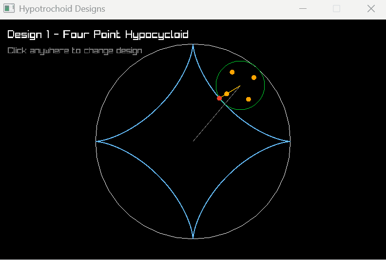

# Hypotrochoid Animation – Midterm 2D

<!-- Add your gameplay GIF below -->
<p align="center">
  
</p>

## About the Project

This project is a 2D mathematical visualization created using **C++ and raylib**. It demonstrates the movement of a smaller circle rolling inside a larger fixed circle and generates different geometric patterns using hypotrochoid equations.

The project focuses on circle movement, rotational motion, mathematical calculations, and real-time curve generation.

## Features

- **Two Circles:** A large stationary circle and a smaller rolling circle.
- **Hypotrochoid Curves:** Generates different geometric patterns using parametric equations.
- **Four Rotating Dots:** Four dots are positioned inside the smaller circle and rotate along with it.
- **Multiple Designs:** Includes four different curve designs.
- **Interactive Switching:** Click the left mouse button to switch between designs.
- **Real-Time Animation:** The rolling circle and tracing point move continuously while the curve is drawn.

## Controls

| Input | Action |
|---|---|
| Left Mouse Click | Switch to the next design |
| Close Window | Exit the application |

## Mathematical Concept

The project uses the hypotrochoid parametric equations:

**X-coordinate:**

\[
x(t)=(R-r)\cos(t)+d\cos\left(\frac{R-r}{r}t\right)
\]

**Y-coordinate:**

\[
y(t)=(R-r)\sin(t)-d\sin\left(\frac{R-r}{r}t\right)
\]

Where:

- **R:** Radius of the large fixed circle.
- **r:** Radius of the smaller rolling circle.
- **d:** Distance between the centre of the smaller circle and the tracing point.
- **t:** Rotation angle.

When \(d=r\), the resulting curve is a hypocycloid, a special type of hypotrochoid.

## Technologies Used

- C++
- raylib
- Premake
- Visual Studio
- Git and GitHub

## Project Structure

```text
Midterm_2D/
│
├── Binaries/
│   ├── Intermediates/
│   └── windows-x86_64/
│
├── build/
│   ├── Game.vcxproj
│   ├── Raylib.vcxproj
│   └── SidheshMidterm_2D.slnx
│
├── Game/
│   ├── include/
│   │   ├── App.h
│   │   └── Spirograph.h
│   │
│   └── src/
│       ├── Hypotrochoid.cpp
│       ├── Hypotrochoid.h
│       └── main.cpp
│
├── Vendor/
│   └── raylib/
│
├── .gitignore
├── Build.lua
└── README.md
```

## Building the Project

1. Clone the repository:

   ```bash
   git clone YOUR_REPOSITORY_URL
   ```

2. Open the project directory.

3. Generate the Visual Studio project files using Premake:

   ```bash
   premake5 --file=Build.lua vs2026
   ```

4. Open the generated solution from the `build` folder:

   ```text
   SidheshMidterm_2D.slnx
   ```

5. Select the **Debug** configuration and **x64** platform.

6. Build and run the `Game` project.

## Author

**Sidhesh**

2D Graphics and Game Programming – Midterm Project