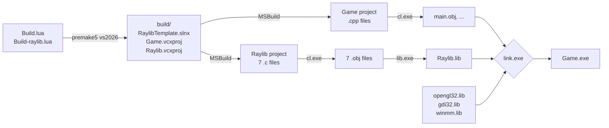

<div align="center">

<h1>Raylib Project Template</h1>

<p><strong>A clean, portable C++20 game project template built on Raylib and Premake.</strong></p>

<p>
  
  
  
  
</p>

<p>
  
  
  
</p>

<p>
  <a href="#quick-start">Quick Start</a> ·
  <a href="#project-structure">Structure</a> ·
  <a href="#how-the-build-works">How It Works</a> ·
  <a href="#starting-a-new-game">New Game</a> ·
  <a href="#troubleshooting">Troubleshooting</a> ·
  <a href="#roadmap">Roadmap</a>
</p>

</div>

---

## Overview

RaylibTemplate is a starting point for 2D and 3D games written in **C++20** with **[Raylib](https://www.raylib.com)**. Instead of shipping prebuilt binaries or Visual Studio files, the repository contains only source code and a **Premake** build description. Project files are generated on demand, and Raylib is compiled from source as part of the workspace.

**Why this matters**

| | |
|---|---|
| **No prebuilt binaries** | Raylib is built by your own compiler, with your own Debug/Release configuration. |
| **No generated files in Git** | Solutions and project files are regenerated from `Build.lua` at any time. |
| **No machine-specific paths** | Every path is relative. Clone the repository anywhere and it builds. |
| **One command to set up** | Clone, generate, open, run. Nothing to install besides Premake and a compiler. |
| **Clean separation** | Your game, the vendored library, generated project files, and build output each live in their own folder. |

---

## Requirements

| Tool | Version | Notes |
|---|---|---|
| **Windows** | 10 or 11 | macOS support is planned (see [Roadmap](#roadmap)) |
| **Visual Studio** | 2026 | Install the **Desktop development with C++** workload |
| **Premake** | 5.0 | `premake5.exe` must be on your `PATH`. Download from the [Premake releases](https://github.com/premake/premake-core/releases) |
| **Git** | any recent | Only needed to clone |

Raylib does **not** need to be installed. Its source is included in `Vendor/raylib/`.

Verify Premake before you start:

```
premake5 --version
```

---

## Quick Start

**1. Clone the repository**

```
git clone https://github.com/<your-username>/RaylibTemplate.git
cd RaylibTemplate
```

No `--recursive` flag is needed: Raylib is vendored directly, not added as a submodule.

**2. Generate the Visual Studio solution**

```
premake5 --file=Build.lua vs2026
```

> [!IMPORTANT]
> The root build script is named `Build.lua`, not `premake5.lua`, so the `--file=Build.lua` argument is required every time.

**3. Open the solution**

```
build/RaylibTemplate.slnx
```

**4. Build and run**

Select `Debug` or `Release`, keep the platform on `x64`, and press **F5**. `Game` is the startup project. Visual Studio builds `Raylib` first, then links it into `Game`, and a window opens.

---

## Project Structure

```
RaylibTemplate/
├── Build.lua                   Root build script: workspace + Game project
├── README.md
├── .gitignore
│
├── Game/                       Your game
│   ├── src/                    .cpp files (subfolders allowed)
│   └── include/                .h files
│
├── Vendor/                     Third-party code, never edited by hand
│   └── raylib/
│       ├── Build-raylib.lua    Build script for the Raylib static library
│       ├── LICENSE             Raylib's zlib license
│       └── src/                Raylib 6.0 source, unchanged from upstream
│
├── build/                      GENERATED: .slnx, .vcxproj files      (not in Git)
└── Binaries/                   GENERATED: executables and libraries  (not in Git)
```

| Folder | Created by | Committed | Safe to delete |
|---|---|---|---|
| `Game/` | You | Yes | No |
| `Vendor/` | You (copied from upstream) | Yes | No |
| `build/` | Premake | No | Yes, regenerate with Premake |
| `Binaries/` | Compiler, archiver, linker | No | Yes, rebuild in Visual Studio |

---

## How the Build Works

### From script to executable



**Premake runs once, before the build.** It only writes project files; it never compiles anything. Everything after that is Visual Studio's build system (MSBuild) driving the compiler (`cl.exe`), the archiver (`lib.exe`), and the linker (`link.exe`).

### The two projects

| Project | Kind | Language | Produces | Defined in |
|---|---|---|---|---|
| **Raylib** | Static library | C | `Raylib.lib` | `Vendor/raylib/Build-raylib.lua` |
| **Game** | Console application | C++20 | `Game.exe` | `Build.lua` |

### How Raylib is compiled

Raylib is built **from source** as its own static library project. Its build script describes exactly what Raylib's own Makefile would do:

| Setting | Value | Purpose |
|---|---|---|
| Source files | the 7 top-level `src/*.c` modules | `rcore`, `rshapes`, `rtextures`, `rtext`, `rmodels`, `raudio`, `rglfw` |
| Include directories | `src`, `src/external/glfw/include` | Raylib's headers and its bundled GLFW headers |
| Defines | `PLATFORM_DESKTOP_GLFW` | Selects the desktop GLFW platform backend |
| | `GRAPHICS_API_OPENGL_33` | Selects OpenGL 3.3 |

> [!NOTE]
> `rglfw.c` is a **unity build** of GLFW: it `#include`s GLFW's source files directly. Files under `src/external/` and `src/platforms/` must therefore **never** be added to the project. They are compiled through Raylib's own `.c` files, and compiling them separately would define symbols twice.

### How Game uses Raylib

| Need | Tool | Configuration |
|---|---|---|
| Find `raylib.h` | Preprocessor | `includedirs { "Vendor/raylib/src" }` |
| Raylib's compiled code | Linker | `links { "Raylib" }` (a project reference, not a file path) |
| Windows libraries Raylib calls | Linker | `opengl32`, `gdi32`, `winmm`, Windows only |
| Correct link order | Linker | `implicitlink "Off"` (see [Troubleshooting](#lnk2005-closewindow-already-defined-in-user32lib)) |

A static library does not carry its own dependencies. The system libraries Raylib needs are therefore linked by `Game`, the project that produces the final executable.

### Output layout

All projects inherit their output folders from the workspace, so every project follows the same pattern:

```
Binaries/<system>-<architecture>/<configuration>/<project>/
Binaries/Intermediates/<system>-<architecture>/<configuration>/<project>/
```

| File | Location |
|---|---|
| `Game.exe` (Debug) | `Binaries/windows-x86_64/Debug/Game/` |
| `Raylib.lib` (Debug) | `Binaries/windows-x86_64/Debug/Raylib/` |
| Object files (`.obj`) | `Binaries/Intermediates/windows-x86_64/<config>/<project>/` |

Different operating systems, architectures, and configurations never overwrite each other's output.

---

## Starting a New Game

1. **Copy the template.** Use GitHub's *Use this template* button, or clone and re-initialize Git.
2. **Rename the workspace** in `Build.lua` (`workspace "RaylibTemplate"`) to your game's name. Do not name the game project `Raylib`; that name is taken by the library project.
3. **Add your code** under `Game/src/` and `Game/include/`.
4. **Regenerate** after adding, removing, or renaming files:

   ```
   premake5 --file=Build.lua vs2026
   ```

> [!WARNING]
> Premake expands file patterns such as `Game/src/**.cpp` **when it runs**, not when you build. A file created after the last generation is invisible to Visual Studio until you regenerate. The typical symptom is an `LNK2019` unresolved symbol error for a function that clearly exists on disk.

### Ground rules

- **`Build.lua` is the source of truth.** Never change settings through Visual Studio's Property Pages: the next regeneration erases them, and they never reach other platforms.
- **Never edit vendored code.** Everything under `Vendor/raylib/src/` stays exactly as shipped by Raylib.
- **Include style:** `<raylib.h>` for external libraries, `"MyHeader.h"` for your own code.

---

## Updating Raylib

1. Download the new Raylib release.
2. Replace **only** `Vendor/raylib/src/` and `Vendor/raylib/LICENSE`. Keep `Build-raylib.lua`.
3. Open the new `src/Makefile` and confirm the default `PLATFORM` / `GRAPHICS` values and the Windows libraries still match `Build-raylib.lua` and `Build.lua`.
4. Delete `build/` and `Binaries/`, regenerate, and rebuild.

---

## Clean Rebuild

Every generated file lives in two folders. To start from a completely clean state:

```
rmdir /s /q build Binaries
premake5 --file=Build.lua vs2026
```

Then rebuild the solution in Visual Studio.

---

## Troubleshooting

Identify the **stage** first: the error prefix tells you which tool failed.

| Prefix | Stage | Typical meaning |
|---|---|---|
| Lua error from `premake5` | Generation | The build script itself is broken |
| `E####` | IntelliSense | Editor analysis only; may be stale. The build output decides |
| `C####` | Compiler / preprocessor | A header, declaration, or syntax problem |
| `LNK####` | Linker | Missing or duplicate definitions |
| Error when launching | Runtime / debugger | The program could not start |

<details>
<summary><strong>C1083: Cannot open include file: 'raylib.h'</strong></summary>

<br>

The preprocessor cannot find the header. Check that the `Game` project has `includedirs { "Vendor/raylib/src" }` in `Build.lua`, then regenerate. The path is relative to `Build.lua`, not to `Build-raylib.lua`. To see what the compiler actually receives, search `build/Game.vcxproj` for `AdditionalIncludeDirectories`.

</details>

<details>
<summary><strong>E1696: cannot open source file "raylib.h" (red squiggles only)</strong></summary>

<br>

This is IntelliSense, not the compiler. If the build succeeds, IntelliSense is stale: close and reopen the solution.

</details>

<details>
<summary><strong>LNK2019: unresolved external symbol __imp_timeBeginPeriod (or similar)</strong></summary>

<br>

A Windows system library is missing from the link. Strip the `__imp_` prefix, look the function up on Microsoft Learn, and check the **Library** row at the bottom of the page. Add that library inside the `filter "system:windows"` block in `Build.lua`.

</details>

<details>
<summary><strong>LNK2005: CloseWindow already defined in user32.lib</strong></summary>

<br>

Both Raylib and the Windows API define a C function named `CloseWindow`. If `user32.lib` reaches the linker before `Raylib.lib`, both definitions get pulled in. The template prevents this with `implicitlink "Off"` in the `Game` project, which places `Raylib.lib` explicitly in the library list ahead of Visual Studio's default libraries.

Do not "fix" this with `/FORCE:MULTIPLE`: the linker would then silently choose one of the two functions.

</details>

<details>
<summary><strong>LNK2019 for a function in a file that exists</strong></summary>

<br>

The file was added after the last generation, so it is not part of the project. Regenerate with Premake and reload the solution.

</details>

<details>
<summary><strong>"Build succeeded" but the debugger cannot find Game.exe</strong></summary>

<br>

The project contains no source files, so nothing was compiled or linked. Check the `files` patterns in `Build.lua`. In Solution Explorer, turn off **Show All Files**: that view shows files on disk, not files in the project.

</details>

---

## Roadmap

- [ ] **Debug / Release settings:** debug symbols, optimization, and runtime library per configuration
- [ ] **macOS support:** Xcode or Makefile generation, Apple framework linking, Objective-C handling for `rglfw.c`
- [ ] **Assets:** an `assets/` folder and a working directory set for the debugger
- [ ] **Warnings:** strict warning levels for game code (MSVC and Clang), kept separate from Raylib
- [ ] **Generation scripts:** one-click `.bat` / `.sh` wrappers around the Premake command

---

## Acknowledgements and Licenses

- **[Raylib](https://github.com/raysan5/raylib)** by Ramon Santamaria and contributors, licensed under the **zlib/libpng license**. See [`Vendor/raylib/LICENSE`](Vendor/raylib/LICENSE).
- **[GLFW](https://www.glfw.org)**, bundled inside Raylib, licensed under the **zlib/libpng license**.
- **[Premake](https://premake.github.io)**, used to generate the project files (not included in this repository).

The template's own code is provided under the license in this repository's `LICENSE` file. Choose and add one before publishing.

<div align="center">
<br>
<sub>Built with Raylib · Generated with Premake · Compiled with MSVC</sub>
</div>